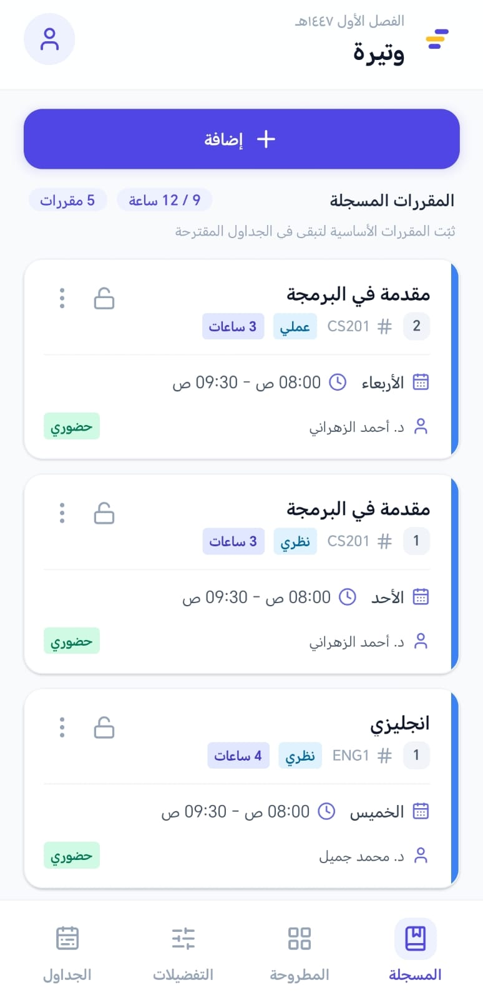
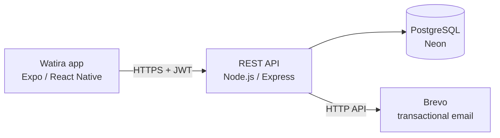
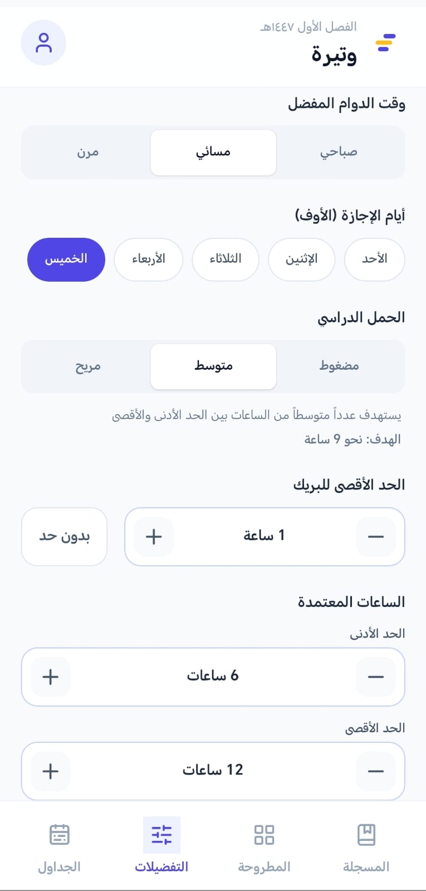
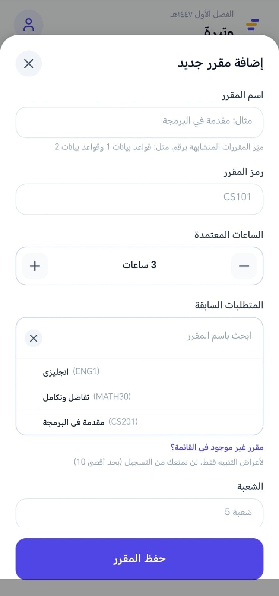
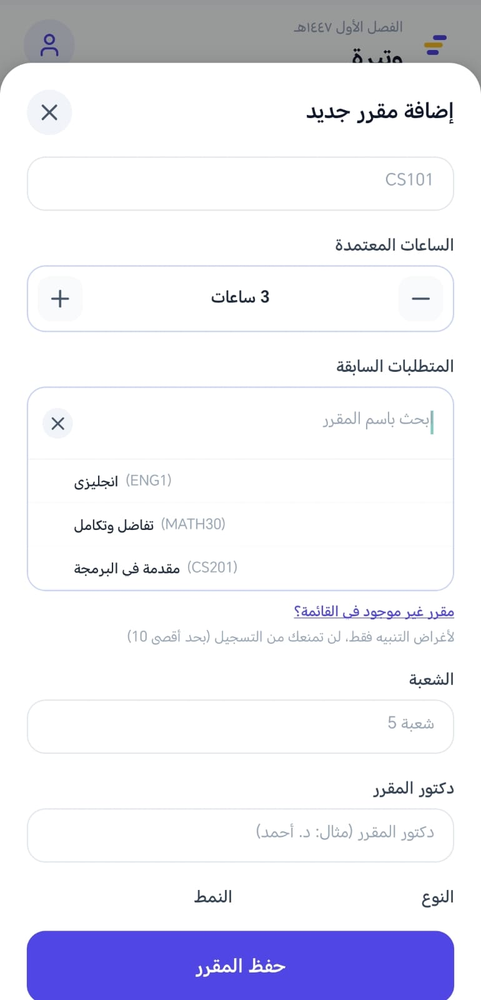

# 🗓️ Watira (وتيرة) - Smart Timetable Planner for University Students

<p align="center">
  
</p>

Watira is a mobile app that helps university students build their course timetable and discover better alternatives. Students enter their registered courses and the offered sections, set their preferences (days off, morning or evening classes, maximum gaps, credit load), and Watira suggests conflict-free timetables ranked by how well they fit. Built with React Native (Expo) and TypeScript on top of a Node.js REST API.

> **Disclaimer:** Watira is an independent project. It is not affiliated with, or endorsed by, any university. It does not register courses on any university system; the final registration is always done by the student on the official portal.

## ✨ Features

* **🧠 Smart Suggestions:** Generates the three best diverse timetable alternatives with a 0 to 100 score, the perks each one achieves (days off, morning or evening, no long breaks), and exactly what changes compared to your current schedule.
* **⚙️ Personal Preferences:** Preferred time of day, days off, study load (compact, medium, relaxed), maximum break length, minimum and maximum credit hours, and blocked times such as prayer breaks.
* **📌 Pinned Courses:** Lock the courses you must keep; the planner never drops them (it may only change their section).
* **🚫 Conflict Detection:** Time conflicts are caught when registering a section, with a guided swap flow when another section of the same course is already registered.
* **🔗 Prerequisites:** Warnings for missing prerequisites, and a searchable multi-select picker (Arabic-aware search) that stays usable with hundreds of courses.
* **📱 Arabic-First UI:** A right-to-left interface with a consistent design system, dialogs, and clear Arabic error messages.
* **🔐 Account Management:** Email and password sign-in, password reset by emailed code, profile editing, password change that signs out other sessions, and in-app account deletion.
* **⏳ Cold-Start Friendly:** A request timeout, a wake-up ping, and a clear "waking the server" indicator, so the app behaves well on a free-tier backend.

## 🧮 How the Scheduling Engine Works

* **Hard constraints:** no overlapping sessions, open sections only, no overlap with blocked times, credit hours within your limits, pinned courses always kept, every added course needs a section for each component (lecture and lab), and no suggesting a course whose prerequisite you are still registered in.
* **Search:** constraint-based backtracking with pruning that widens gradually by the number of changes (0, then 1, then 2, ...), with a safety cap on explored nodes.
* **Scoring:** a weighted average of the preferences you enabled: days off (35), time of day (25), maximum break (20), study load (20), minus a penalty for each change (swap a section, add a course, drop a course).
* **Transparency:** your current schedule is scored too, so the app tells you honestly when it is already better than the alternatives.

## 🛠️ Tech Stack

* **Mobile app (this repository):** React Native (Expo SDK 57), Expo Router, TypeScript, NativeWind, Context API, Expo Secure Store
* **Backend (separate repository):** Node.js, Express 5, TypeScript, Prisma ORM, PostgreSQL, Zod validation, JWT, bcrypt, rate limiting, Helmet
* **Testing (backend):** Vitest and Supertest, with 230+ automated tests including per-student data isolation
* **Infrastructure:** Render (API), Neon (PostgreSQL), Brevo (transactional email), EAS Build (Android builds)
* **Version Control:** Git & GitHub

## 🏗️ Architecture



The server is the single source of truth: the app loads sections, schedules, and preferences from the API, and every action goes through it. The backend lives in a separate repository.

## 🎨 App Screenshots

### 🔐 Sign In & Planner
| Sign In | My Schedule |
| :---: | :---: |
|  |  |

### 🧠 Suggestions & Preferences
| Suggested Alternatives | Preferences |
| :---: | :---: |
|  |  |

### 📚 Course Management
| Add a Course | Prerequisites Picker |
| :---: | :---: |
|  |  |

## 📥 Download

* **Android APK:** download the latest build from the [Releases](https://github.com/anas-roshdi/watira-app/releases/latest) page.
* **Google Play:** release in preparation.

> **Note:** the API runs on a free hosting tier, so the first request after a period of inactivity can take up to a minute while the server wakes up.

## 🚀 Installation & Setup

1. Clone the repository:
   ```bash
   git clone https://github.com/anas-roshdi/watira-app.git
   ```
2. Navigate to the project directory:
   ```bash
   cd watira-app
   ```
3. Install the dependencies:
   ```bash
   npm install
   ```
4. Create a `.env` file from the example and set the API address:
   ```bash
   cp .env.example .env
   # EXPO_PUBLIC_API_URL=https://your-api-host
   ```
5. Start the development server:
   ```bash
   npx expo start
   ```

The app needs the Watira API to work. The hosted API address used by the release builds is configured in `eas.json`. If you change `.env`, restart with `npx expo start -c`.

## 📦 Building an APK

```bash
npm install -g eas-cli
eas login
eas build -p android --profile preview
```

## 🗺️ Roadmap

* Google Play release
* Importing offered courses from a file, with a shared catalog per semester
* Smaller download size through Android App Bundles

## 👤 Author

**Anas Tilika** - Mobile Application Developer

[GitHub](https://github.com/anas-roshdi) | [LinkedIn](https://www.linkedin.com/in/anas-tilika-925a6b212/) | [Portfolio](https://developer-portfolio-gules-mu.vercel.app/)
